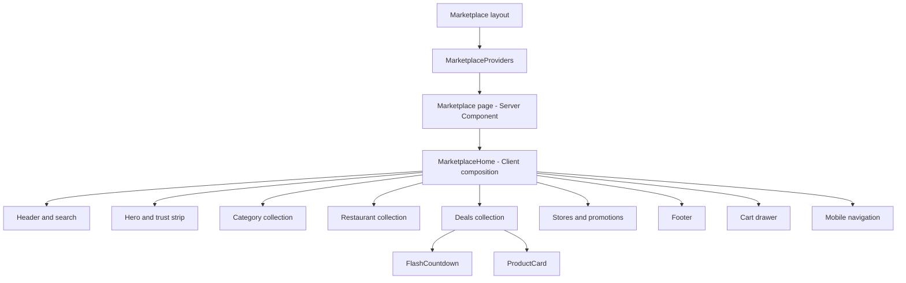

# Marketplace architecture and component design

Status: current local reconstruction, followed by an explicit growth plan. Entry point: [implementation plan](marketplace-implementation-plan.md). Product backlog: [roadmap](marketplace-roadmap.md).

## Active implementation policy

UI-first with local data only, by explicit user instruction. Complete all Marketplace
journeys before backend integration. Existing reference data is the starting point;
additional states use labeled mock scenarios, not invented original-site records.
Use local functions/state to simulate asynchronous results where useful, without
HTTP requests, Next route handlers, database services or existing storefront APIs.
Keep demo transactions/accounts distinguishable from real operations. Do not
persist customer PII, passwords or payment credentials. The integration directions
below describe a future phase and are not authorization to implement it now.
Backend work begins only after UI-flow completion and an explicit user request.

## Boundaries

`apps/storefront` contains two separate product surfaces: the Marketplace under `/marketplace`, and tenant storefronts under `/s/[slug]`. The business landing page `/` and merchant application `/join` also remain active. Marketplace cleanup does not retire these routes, their fonts, assets, shared components, or API integrations.

Next.js App Router owns routing. `app/marketplace` contains thin route files and layout wiring. The Marketplace feature owns its compositions, fixture data, state, and provider. Only components shared by multiple Marketplace compositions belong in `src/components/marketplace`. Generic primitives shared across applications belong in `packages/ui` only when a real reuse case exists.

## Current folder structure

```text
apps/storefront/src/
  app/marketplace/
    layout.tsx                         # Theme, metadata, RTL and provider boundary
    page.tsx                           # Route entry
  components/marketplace/
    marketplace-container.tsx          # Container primitive
    section-heading.tsx                # Shared heading primitive
    marketplace-dialog.tsx             # Native modal lifecycle and dismissal
  features/marketplace/
    components/
      home/
        marketplace-home.tsx           # Composition and local search/toast coordination
        marketplace-hero.tsx            # Hero and trust strip
        marketplace-stores.tsx         # Stores, seller promotion and app strip
      navigation/
        marketplace-header.tsx         # Search form, navigation and cart entry
        marketplace-footer.tsx
        marketplace-mobile-nav.tsx
        marketplace-menu.tsx
        marketplace-navigation-links.tsx
        marketplace-pending-feature.tsx
        navigation-items.ts
        use-marketplace-navigation.ts
      catalog/
        marketplace-categories.tsx
        marketplace-restaurants.tsx
        marketplace-products.tsx       # Filtered collection and empty state
        product-card.tsx               # Product rendering and user actions
        flash-countdown.tsx            # Timer lifecycle
      cart/
        marketplace-cart.tsx           # Drawer, removal, totals and focus management
    data/reference.json                # Extracted reference content, not production records
    search/
      search-state.ts                  # Pure URL parsing/serialization and category mapping
      use-marketplace-search.ts        # URL state and native History integration
      marketplace-search-form.tsx      # Local draft form
    model/
      catalog.ts                       # Current fixture filtering, cart lookup and formatting
      marketplace-store.ts             # Cart IDs, favorites IDs, drawer state
      marketplace.test.ts              # Search/cart/favorites behavior tests
    providers/
      marketplace-providers.tsx        # QueryClient + scoped Zustand context and hook
  styles/marketplace.css                # Scoped reference CSS and Tailwind token mapping
```

The folder split follows existing responsibilities; it does not create empty checkout, auth, repository, service, or API layers in advance. `model/catalog.ts` remains small. Extract cart selectors/formatting when production cart contracts make that boundary meaningful.

Business pages use `app/(business)/layout.tsx` to render WorkspaceChrome, with `/` in `(business)/page.tsx` and `/join` under `(business)/join`. The group name is not part of either URL. Root layout owns global providers and document markup; Marketplace and tenant storefront layouts own their respective surfaces. The old SiteChrome component and pathname-based chrome switching have been removed.

## Component composition



Header composes the search form; it does not own catalog data. Search drafts stay in the form, while submitted search/category state comes from the URL. Category selection retains the committed query; unsubmitted typing does not affect it. Categories receive an active local category ID and selection callback. Shared typed destinations power desktop and modal navigation. ProductCard receives a product and add-feedback callback, and reads only the store slices it needs. Cart derives entries and totals; no separate total is stored. See [navigation slice](marketplace-navigation.md) for current behavior and QA limits.

Static sections currently sit below the Home client boundary. A future server-data slice can pass static server-rendered sections as slots or props while retaining search, cart, favorite, countdown and form islands as Client Components. Merely moving a file does not make it a Server Component; avoid claiming a bundle reduction until measured. Preserve the reference DOM/classes during extraction.

## State ownership

| State                                | Current owner                           | Production direction                                                                |
| ------------------------------------ | --------------------------------------- | ----------------------------------------------------------------------------------- |
| Extracted catalog                    | Read-only reference.json                | Initial public reads in Next server data layer; typed adapters                      |
| Search draft and submitted filter    | Form local draft / URL filter           | Draft stays local; submitted search/category/sort/page in URL                       |
| Drawer open, cart IDs, favorites IDs | Per-provider Zustand store              | Non-sensitive client preferences and drafts; IDs/quantity only for persistence      |
| Cart total                           | Derived local preview value             | Server quote/order totals authoritative; decimal strings at transport boundary      |
| Countdown                            | Component timer                         | Server offer deadline when a real promotion contract exists                         |
| Toast and focused element            | Local component lifecycle               | Remain local                                                                        |
| Interactive remote data/mutations    | QueryClient provisioned; no queries yet | React Query for quote, mutation, retry and invalidation; never duplicate in Zustand |
| Customer identity/orders             | Not implemented                         | Approved customer session/API; never fixtures represented as live account data      |

Both store and QueryClient are created once per mounted provider, not as module-level mutable singletons. Cart currently resets on reload and retains separate duplicate lines to match the reference. Changing to quantity-based lines is a planned product behavior change, not part of this cleanup.

## Data and backend integration

Current reference content is not an API contract. Its numeric IDs must never be sent to production order endpoints. Introduce API-specific mapping only after the endpoint and shared transport types exist. Keep fixture mode explicit and separated from live checkout; no fallback from failed production API calls to fabricated products or successful orders.

Existing public catalog/quote routes are owned by Storefront composition and Catalog pricing; order creation is owned by Orders. Extend the owning module through its public exports and preserve dependency direction. Frontends must not import Prisma or API implementations. See [API architecture](architecture/API_ARCHITECTURE.md), [API instructions](../apps/api/AGENTS.md), and the [integration inventory in the roadmap](marketplace-roadmap.md).

## Styling and change rules

- Marketplace variables/styles remain scoped under `.marketplace-theme`; Tailwind utilities map to the same tokens.
- The inspected Tahoma stack, original images, emoji/symbol icons and authored CSS preserve this reference. The restaurant storefront has its own approved design and must not be converted to this theme.
- Extract a repeated card only when its structure and behavior really match. Restaurant, product and store cards are separate compositions.
- Retain reports and the raw `docs/reference/marketplace/source.html` snapshot for visual validation. The one-off extractor and duplicate asset URL list have been removed. Maintain the extracted app data and scoped stylesheet directly, using the snapshot and assets manifest as evidence.
- New API work must identify owner, tenant scope, transaction rules, transport types, pending/error states and verification before implementation.
